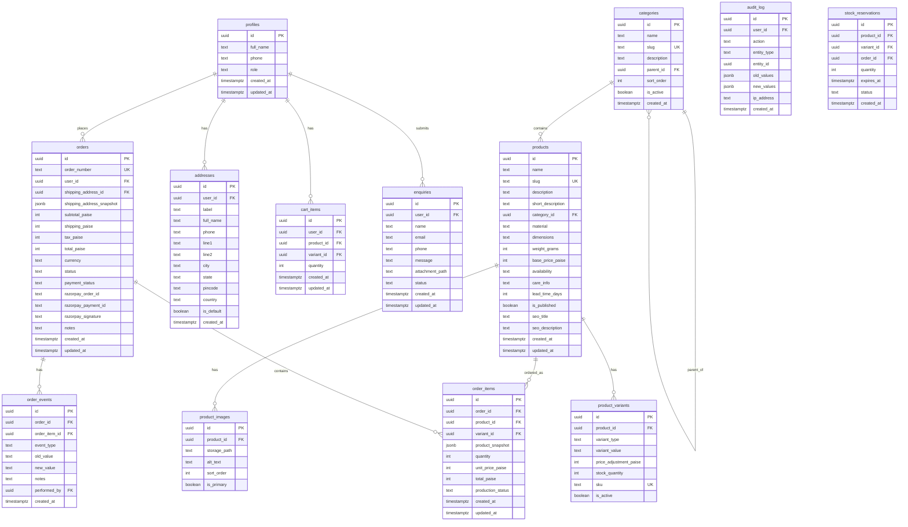

# Data Model — Falcon 3D Prints

> Proposed PostgreSQL schema for Supabase. All monetary values in integer paise (INR × 100).

## Entity relationship diagram



## Table details

### `profiles`

Extends Supabase `auth.users`. Created via trigger on `auth.users` INSERT.

| Column | Type | Constraints | Notes |
|---|---|---|---|
| `id` | uuid | PK, references `auth.users(id)` | Same as auth user ID |
| `full_name` | text | NOT NULL | Display name |
| `phone` | text | | Optional phone number |
| `role` | text | NOT NULL, DEFAULT 'customer' | Enum: 'customer', 'owner', 'order_manager', 'production_operator', 'support', 'catalog_editor' |
| `created_at` | timestamptz | NOT NULL, DEFAULT now() | |
| `updated_at` | timestamptz | NOT NULL, DEFAULT now() | Updated via trigger |

**RLS**: Users can read/update their own profile. Admins can read all profiles. Only owner can change roles.

### `products`

| Column | Type | Constraints | Notes |
|---|---|---|---|
| `id` | uuid | PK, DEFAULT gen_random_uuid() | |
| `name` | text | NOT NULL | Product display name |
| `slug` | text | NOT NULL, UNIQUE | URL-safe identifier |
| `description` | text | | Full description (supports markdown) |
| `short_description` | text | | Card/listing description |
| `category_id` | uuid | FK → categories(id) | |
| `material` | text | | e.g., "PLA", "PETG", "ABS" |
| `dimensions` | text | | e.g., "15cm × 10cm × 8cm" |
| `weight_grams` | int | | Weight in grams |
| `base_price_paise` | int | NOT NULL, CHECK (> 0) | Price in paise |
| `availability` | text | NOT NULL, DEFAULT 'in_stock' | Enum: 'in_stock', 'made_to_order', 'out_of_stock' |
| `care_info` | text | | Handling/care instructions |
| `lead_time_days` | int | | For made_to_order items |
| `is_published` | boolean | NOT NULL, DEFAULT false | Only published products show on storefront |
| `seo_title` | text | | Custom SEO title |
| `seo_description` | text | | Custom meta description |
| `created_at` | timestamptz | NOT NULL, DEFAULT now() | |
| `updated_at` | timestamptz | NOT NULL, DEFAULT now() | |

**RLS**: Public read for published products. Admin write.

### `orders`

| Column | Type | Constraints | Notes |
|---|---|---|---|
| `order_number` | text | NOT NULL, UNIQUE | Human-readable (e.g., "FP-20261011-001") |
| `user_id` | uuid | FK → profiles(id) | NULL for guest checkout |
| `shipping_address_snapshot` | jsonb | NOT NULL | Immutable copy of address at order time |
| `subtotal_paise` | int | NOT NULL, CHECK (>= 0) | Sum of item totals |
| `shipping_paise` | int | NOT NULL, CHECK (>= 0) | Shipping cost |
| `tax_paise` | int | NOT NULL, CHECK (>= 0) | Tax amount |
| `total_paise` | int | NOT NULL, CHECK (> 0) | Grand total |
| `currency` | text | NOT NULL, DEFAULT 'INR' | Always INR |
| `status` | text | NOT NULL, DEFAULT 'pending' | Enum: 'pending', 'confirmed', 'processing', 'packed', 'shipped', 'delivered', 'cancelled' |
| `payment_status` | text | NOT NULL, DEFAULT 'pending' | Enum: 'pending', 'captured', 'failed', 'refunded' |
| `razorpay_order_id` | text | UNIQUE | Razorpay order reference |
| `razorpay_payment_id` | text | | Razorpay payment reference |

**RLS**: Customers see their own orders. Admins see all orders.

### `order_items`

| Column | Type | Constraints | Notes |
|---|---|---|---|
| `product_snapshot` | jsonb | NOT NULL | Immutable copy of product details at order time |
| `production_status` | text | DEFAULT 'not_applicable' | Enum: 'not_applicable', 'queued', 'printing', 'finishing', 'quality_check', 'qc_failed', 'ready', 'packed', 'shipped' |

**Production status transitions**:
- `not_applicable`: Ready-stock items skip production
- `queued` → `printing` → `finishing` → `quality_check` → `ready` → `packed` → `shipped`
- `quality_check` → `qc_failed` → `queued` (reprint)

### `stock_reservations`

Temporary stock holds during checkout.

| Column | Type | Notes |
|---|---|---|
| `expires_at` | timestamptz | Reservation expires (e.g., 30 minutes) |
| `status` | text | 'active', 'converted', 'expired', 'released' |

A background job or database function should release expired reservations.

## Indexes

```sql
-- Product lookups
CREATE INDEX idx_products_slug ON products(slug) WHERE is_published = true;
CREATE INDEX idx_products_category ON products(category_id) WHERE is_published = true;
CREATE INDEX idx_products_search ON products USING gin(to_tsvector('english', name || ' ' || coalesce(description, '')));

-- Order lookups
CREATE INDEX idx_orders_user ON orders(user_id);
CREATE INDEX idx_orders_status ON orders(status);
CREATE INDEX idx_orders_created ON orders(created_at DESC);
CREATE INDEX idx_orders_razorpay ON orders(razorpay_order_id);

-- Order items
CREATE INDEX idx_order_items_order ON order_items(order_id);
CREATE INDEX idx_order_items_production ON order_items(production_status) WHERE production_status != 'not_applicable';

-- Cart
CREATE INDEX idx_cart_user ON cart_items(user_id);

-- Stock reservations
CREATE INDEX idx_reservations_active ON stock_reservations(expires_at) WHERE status = 'active';
```

## Rounding rules

1. **Product price**: Stored exactly in paise. No rounding.
2. **Variant price**: `base_price_paise + price_adjustment_paise`. No rounding.
3. **Line item total**: `unit_price_paise × quantity`. No rounding (integer multiplication).
4. **Subtotal**: Sum of line item totals. No rounding.
5. **Tax**: `ROUND(subtotal_paise × tax_rate)`. Round to nearest paise. Half-up.
6. **Shipping**: Fixed amount in paise. No rounding.
7. **Grand total**: `subtotal_paise + tax_paise + shipping_paise`. No rounding.

All rounding decisions are documented and testable.
