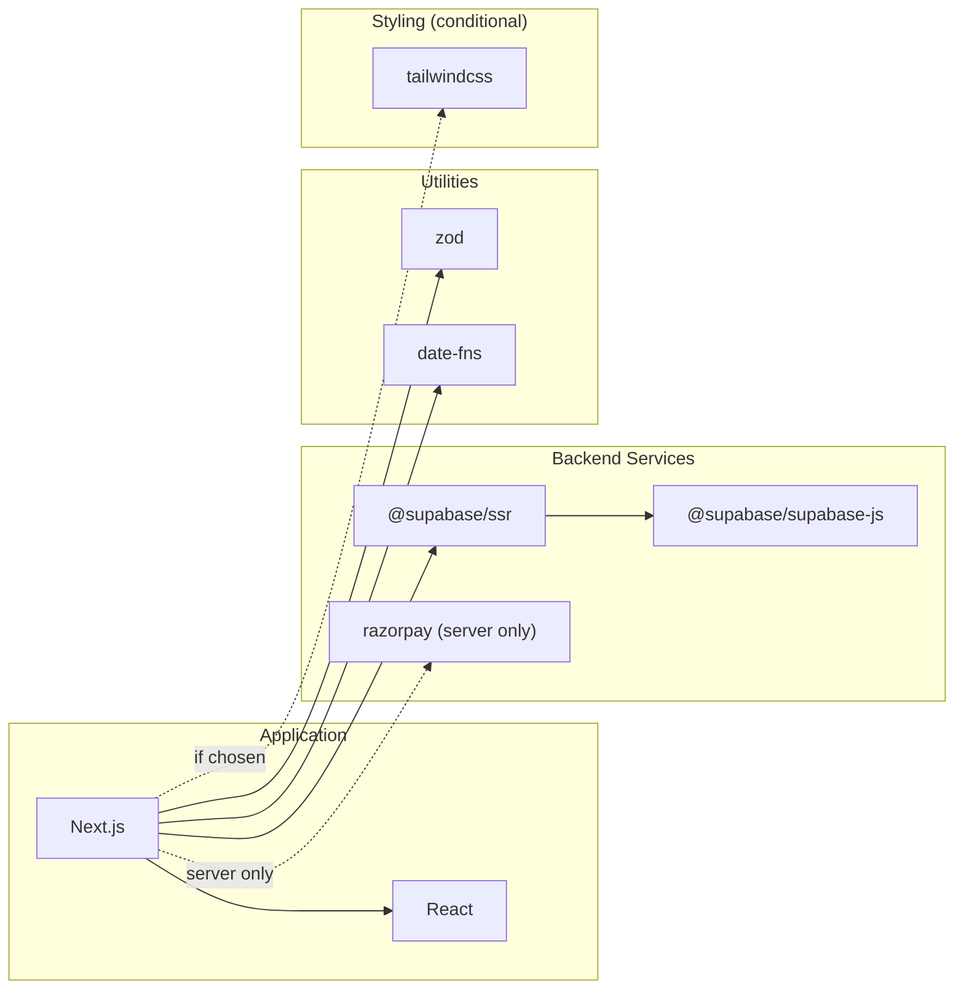

# Dependency Map — Falcon 3D Prints

> Expected runtime and dev dependencies with rationale. Verify current versions against npm before installing.

## Runtime dependencies

| Package | Purpose | Required by |
|---|---|---|
| `next` (14+) | Application framework | Everything |
| `react`, `react-dom` (18+) | UI library | Everything |
| `@supabase/supabase-js` | Supabase client (auth, db, storage) | Auth, data, storage |
| `@supabase/ssr` | Supabase helpers for SSR/SSG | Server components, middleware |
| `razorpay` | Razorpay Node.js SDK (server-side) | Payment processing |
| `zod` | Schema validation | Input validation, form validation |
| `date-fns` or `dayjs` | Date formatting/manipulation | Order dates, timestamps |

## Dev dependencies

| Package | Purpose | Required by |
|---|---|---|
| `typescript` | Language | Everything |
| `@types/node`, `@types/react` | Type definitions | TypeScript compilation |
| `eslint`, `eslint-config-next` | Linting | Code quality |
| `prettier` | Code formatting | Code quality |
| `supabase` (CLI) | Local dev, migrations, type generation | Database development |
| `vitest` | Unit/integration testing | Testing |
| `@playwright/test` | End-to-end testing | E2E testing |
| `@axe-core/playwright` or `axe-core` | Accessibility testing | Accessibility audit |

## Conditional dependencies (install only if chosen)

| Package | Condition | Purpose |
|---|---|---|
| `tailwindcss`, `postcss`, `autoprefixer` | If ADR-007 selects Tailwind | Styling |
| `framer-motion` or `motion` | If animations require orchestration beyond CSS | UI motion |
| `@google/model-viewer` | If 3D preview feature is approved (ADR-008) | 3D product viewer |
| `sharp` | If custom image processing needed | Image optimisation |
| `@react-email/components`, `resend` | If dedicated email service chosen | Transactional emails |
| `lucide-react` or `@heroicons/react` | If icon library needed | Icons |

## What NOT to install

| Package | Reason |
|---|---|
| `express`, `koa`, `fastify` | Next.js handles HTTP |
| `mongoose`, `prisma`, `drizzle` | Supabase client handles DB access |
| `passport`, `next-auth` | Supabase Auth handles authentication |
| `stripe` | Using Razorpay, not Stripe |
| `gsap` + `framer-motion` | Pick one animation library, not both |
| `lodash` (full) | Import specific functions or write utilities |
| `moment` | Deprecated; use date-fns or dayjs |
| `axios` | Use native fetch (Next.js extends it) |

## Dependency diagram

## Version pinning strategy

- Pin major versions in `package.json` (e.g., `"next": "^14.0.0"`).
- Use `package-lock.json` for exact reproducibility.
- Update dependencies in a dedicated task, not mixed with feature work.
- Test after every dependency update.
