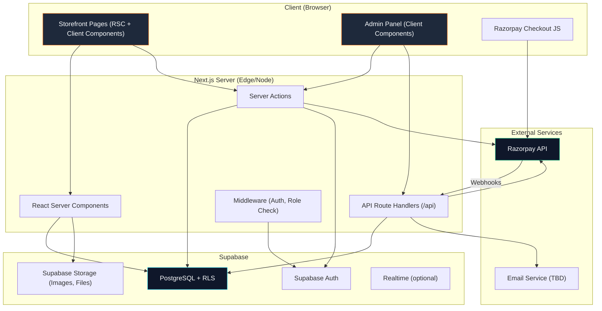
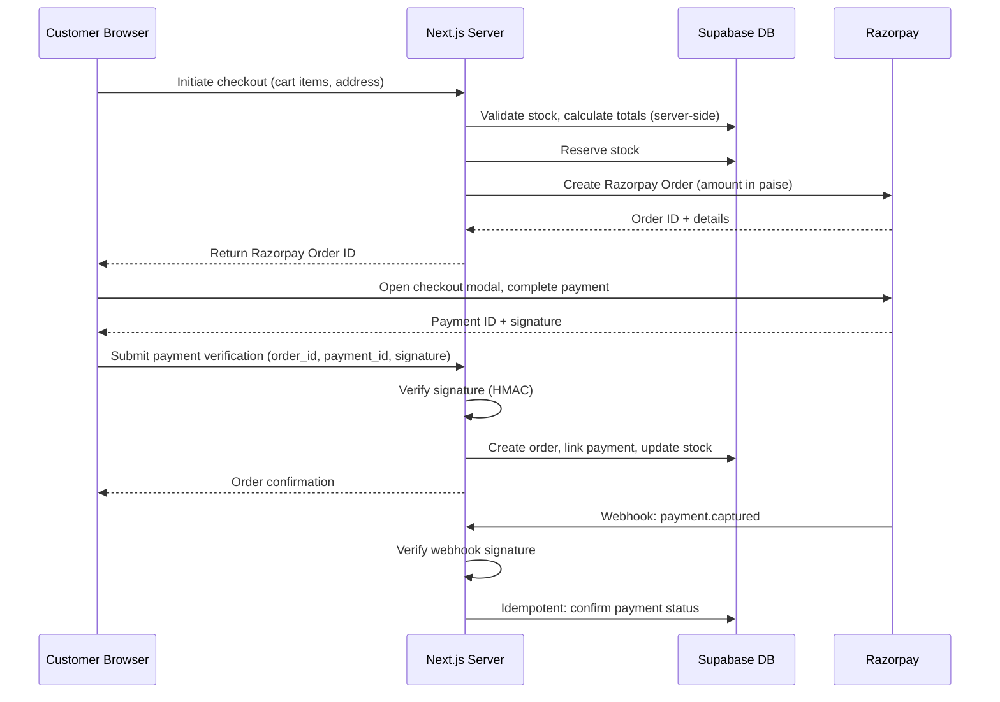

# System Overview — Falcon 3D Prints

## Architecture diagram

## Component responsibilities

### Client layer

| Component | Responsibility |
|---|---|
| **Storefront pages** | Product browsing, cart, checkout, account management. React Server Components where possible, Client Components for interactivity (cart drawer, search, forms). |
| **Admin panel** | Product management, order management, production tracking, reporting. Primarily Client Components due to heavy interactivity. |
| **Razorpay Checkout JS** | Client-side payment modal. Loaded only on checkout page. Communicates directly with Razorpay, then reports back to our server. |

### Server layer

| Component | Responsibility |
|---|---|
| **React Server Components** | Data fetching, page rendering. No client-side JS shipped. Used for product pages, category pages, static content. |
| **API Route Handlers** | Webhook receivers (Razorpay), any REST-style endpoints needed by external services. Thin — delegate to feature services. |
| **Server Actions** | Mutations (add to cart, place order, update product, change order status). Server-authoritative business logic. |
| **Middleware** | Authentication check, role verification, redirect unauthenticated users, CSRF validation. |

### Data layer

| Component | Responsibility |
|---|---|
| **Supabase Auth** | User registration, login, session management, password reset, email verification. Manages JWT tokens. |
| **PostgreSQL + RLS** | All application data. Row-Level Security enforces data isolation. No direct client access to data without RLS. |
| **Supabase Storage** | Product images, enquiry file attachments. Access controlled by storage policies. |
| **Realtime** | Optional — could be used for admin notifications or live order status updates. Not required for MVP. |

### External services

| Service | Responsibility |
|---|---|
| **Razorpay** | Payment processing. Server creates orders, client displays checkout, server verifies payment, webhooks confirm asynchronous events. |
| **Email** | Transactional emails (order confirmation, password reset, enquiry notification). Provider TBD (see Q-014). Supabase handles auth emails. |

## Data flow: Purchase

## Security boundaries

| Boundary | Protection |
|---|---|
| Client ↔ Server | HTTPS, CSRF tokens, input validation |
| Server ↔ Database | Supabase RLS, parameterised queries, no raw SQL from user input |
| Server ↔ Razorpay | API key auth (server-side only), HMAC signature verification |
| Admin ↔ Server | Role-based middleware, server-enforced permissions |
| Customer ↔ Customer | RLS policies enforce data isolation |
| Service role key | Never in client bundle. Only used in server-side code behind auth check. |
