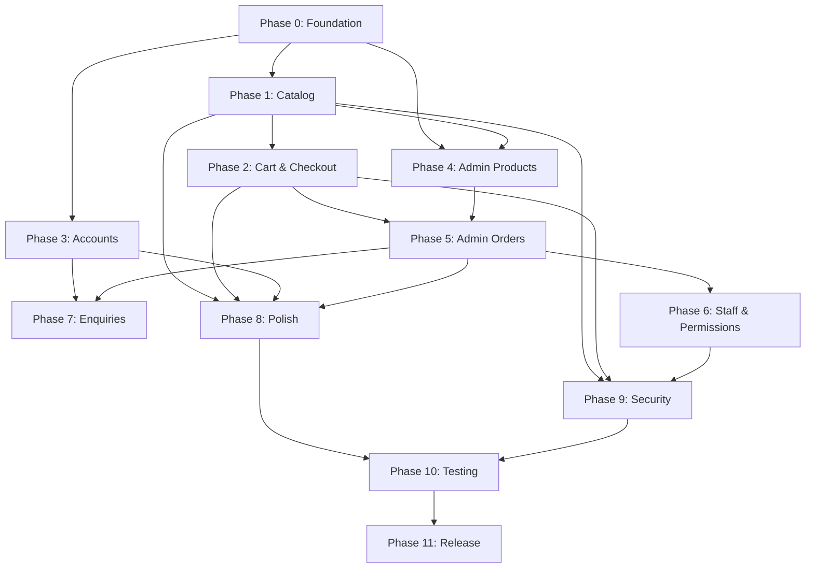

# Implementation Roadmap — Falcon 3D Prints

> Phased plan with dependency-aware ordering. Each phase produces a verifiable increment.

## Phase overview

| Phase | Name | Duration estimate | Depends on | Deliverable |
|---|---|---|---|---|
| 0 | Foundation | 1-2 days | Brand assets (Q-005) | Scaffolded project, design system, database schema |
| 1 | Catalog & storefront | 3-5 days | Phase 0 | Browsable product catalog with categories |
| 2 | Cart & checkout | 3-5 days | Phase 1, Razorpay sandbox (Q-011) | Working purchase flow |
| 3 | Customer accounts | 2-3 days | Phase 0 (auth) | Registration, login, order history |
| 4 | Admin — Products | 2-3 days | Phase 0, Phase 1 | Product CRUD, image upload, categories |
| 5 | Admin — Orders & production | 3-4 days | Phase 2, Phase 4 | Order management, production pipeline |
| 6 | Admin — Staff & permissions | 2-3 days | Phase 5 | Role-based access, audit trail |
| 7 | Enquiries & quotes | 2-3 days | Phase 3, Phase 5 | Enquiry form, admin responses, quotes |
| 8 | Polish & performance | 2-3 days | Phase 1-7 | Animations, image optimisation, caching |
| 9 | Security hardening | 2-3 days | Phase 1-7 | Threat model verification, rate limiting |
| 10 | Testing & QA | 3-5 days | Phase 1-7 | Test suite, accessibility audit, load testing |
| 11 | Release preparation | 1-2 days | Phase 8-10 | Deployment config, monitoring, documentation |

**Total estimated**: 24-38 working days (not calendar days — depends on team size and business decisions)

---

## Phase 0: Foundation

### Prerequisites
- [ ] Business owner provides brand assets (logo files — SVG preferred)
- [ ] Business owner confirms styling preference (Tailwind vs vanilla CSS)
- [ ] Razorpay test/sandbox credentials available

### Tasks

#### 0.1 Project scaffolding
- Initialise Next.js 14+ with App Router, TypeScript strict mode
- Configure ESLint, Prettier
- Set up folder structure per `docs/architecture/folder-structure.md`
- Create environment variable schema (`.env.example`)
- **Skill**: `falcon-engineering`
- **Verify**: `npm run build` succeeds, `npm run lint` passes

#### 0.2 Supabase setup
- Create Supabase project (development)
- Write initial migration: core tables (see `data-model.md`)
- Configure RLS policies for all tables
- Set up storage buckets (product-images, enquiry-attachments)
- Write storage policies
- **Skill**: `falcon-data-integrations`
- **Verify**: Migration applies cleanly, RLS policies block unauthorised access

#### 0.3 Design system
- Define colour tokens (based on brand guidelines)
- Define typography scale
- Define spacing scale
- Build base UI components: Button, Input, Card, Badge, Modal, Toast
- **Skill**: `falcon-brand`, `falcon-premium-experience`
- **Verify**: Storybook or isolated component page renders all components

#### 0.4 Auth foundation
- Configure Supabase Auth (email/password)
- Create auth middleware for protected routes
- Create role-checking utilities
- **Skill**: `falcon-auth-security`
- **Verify**: Login/logout works, protected route redirects unauthenticated users

### Phase 0 exit criteria
- [ ] Project builds and runs locally
- [ ] Database schema applied with RLS
- [ ] Design system components render correctly
- [ ] Auth flow works end-to-end
- [ ] All code passes lint

---

## Phase 1: Catalog & storefront

### Tasks

#### 1.1 Product listing page
- Server component that fetches published products
- Responsive grid with product cards
- Category navigation (sidebar or top bar)
- **Skill**: `falcon-storefront`

#### 1.2 Product detail page
- Dynamic route `/product/[slug]`
- Image gallery
- Variant selection
- Add to cart button
- SEO metadata
- **Skill**: `falcon-storefront`

#### 1.3 Category pages
- Dynamic route `/category/[slug]`
- Filtered product listing
- Breadcrumbs
- **Skill**: `falcon-storefront`

#### 1.4 Search
- Search bar in header
- Server-side full-text search
- Search results page
- **Skill**: `falcon-storefront`

#### 1.5 Homepage
- Hero section with brand messaging
- Featured products
- Category highlights
- **Skill**: `falcon-storefront`, `falcon-premium-experience`

### Phase 1 exit criteria
- [ ] Products display correctly from database
- [ ] Category filtering works
- [ ] Search returns relevant results
- [ ] All pages have SEO metadata
- [ ] Pages are responsive and accessible
- [ ] LCP < 2.5s on product listing

---

## Phase 2: Cart & checkout

### Tasks

#### 2.1 Cart state management
- Server-side cart for authenticated users
- localStorage cart for guests
- Cart merge on login
- **Skill**: `falcon-commerce`

#### 2.2 Cart UI
- Mini-cart drawer accessible from header
- Full cart page
- Quantity adjustment, item removal
- **Skill**: `falcon-commerce`, `falcon-ui-motion`

#### 2.3 Checkout flow
- Shipping address form with validation
- Server-side price/tax/shipping calculation
- Order summary review
- **Skill**: `falcon-commerce`

#### 2.4 Razorpay integration
- Server: create Razorpay order with correct amount in paise
- Client: Razorpay checkout modal
- Server: verify payment signature
- Webhook handler for async payment confirmation
- Idempotent webhook processing
- **Skill**: `falcon-commerce`, `falcon-data-integrations`

#### 2.5 Order confirmation & failure
- Success page with order number
- Failure page with retry option
- Pending state handling
- **Skill**: `falcon-commerce`

### Phase 2 exit criteria
- [ ] Complete purchase flow works in Razorpay sandbox
- [ ] Payment signature is verified server-side
- [ ] Duplicate webhooks don't create duplicate actions
- [ ] Failed payment doesn't create an order
- [ ] Stock is reserved and released correctly
- [ ] All prices calculated server-side in paise

---

## Phase 3: Customer accounts

#### 3.1 Registration & login pages
#### 3.2 Email verification flow
#### 3.3 Password reset flow
#### 3.4 Account dashboard (order history, addresses)
#### 3.5 Profile management

**Skill**: `falcon-auth-security`, `falcon-storefront`

### Phase 3 exit criteria
- [ ] Full registration-to-login flow works
- [ ] Password reset works
- [ ] Order history displays correctly
- [ ] Address management works

---

## Phase 4: Admin — Products

#### 4.1 Admin layout and navigation
#### 4.2 Product list with search/filter
#### 4.3 Product create/edit form with image upload
#### 4.4 Category management
#### 4.5 Draft/publish workflow

**Skill**: `falcon-admin`, `falcon-data-integrations`

### Phase 4 exit criteria
- [ ] Product CRUD works end-to-end
- [ ] Images upload to Supabase Storage and display on storefront
- [ ] Draft products hidden from storefront
- [ ] Admin route protected from non-admin users

---

## Phase 5: Admin — Orders & production

#### 5.1 Order list with filters
#### 5.2 Order detail with timeline
#### 5.3 Production pipeline for made-to-order items
#### 5.4 QC failure handling and requeue
#### 5.5 Partial fulfilment

**Skill**: `falcon-admin`, `falcon-commerce`

---

## Phase 6: Admin — Staff & permissions

#### 6.1 Role definition and assignment
#### 6.2 Server-side permission enforcement
#### 6.3 Audit logging
#### 6.4 Optimistic locking for concurrent edits

**Skill**: `falcon-admin`, `falcon-auth-security`

---

## Phase 7: Enquiries & quotes

#### 7.1 Customer-facing enquiry form
#### 7.2 Admin enquiry management
#### 7.3 Quote creation and customer approval flow

**Skill**: `falcon-storefront`, `falcon-admin`

---

## Phase 8: Polish & performance

#### 8.1 UI animations and micro-interactions
#### 8.2 Image optimisation pipeline
#### 8.3 Caching strategy (ISR, CDN headers)
#### 8.4 Loading states and skeleton screens
#### 8.5 Error boundaries and fallback UI

**Skill**: `falcon-ui-motion`, `falcon-performance-accessibility`, `falcon-premium-experience`

---

## Phase 9: Security hardening

#### 9.1 Threat model verification against code
#### 9.2 Rate limiting implementation
#### 9.3 CSRF protection audit
#### 9.4 Input validation audit
#### 9.5 RLS policy verification
#### 9.6 Secret exposure scan

**Skill**: `falcon-auth-security`, `falcon-testing`
**Workflow**: `review-security.md`

---

## Phase 10: Testing & QA

#### 10.1 Unit tests for business logic
#### 10.2 Integration tests for API routes
#### 10.3 E2E tests for critical paths
#### 10.4 Accessibility audit
#### 10.5 Performance audit

**Skill**: `falcon-testing`, `falcon-performance-accessibility`

---

## Phase 11: Release preparation

#### 11.1 Hosting/deployment configuration
#### 11.2 Environment setup documentation
#### 11.3 Migration rehearsal
#### 11.4 Monitoring setup
#### 11.5 Release checklist completion

**Skill**: `falcon-release-operations`
**Workflow**: `verify-release.md`

---

## Dependency graph

